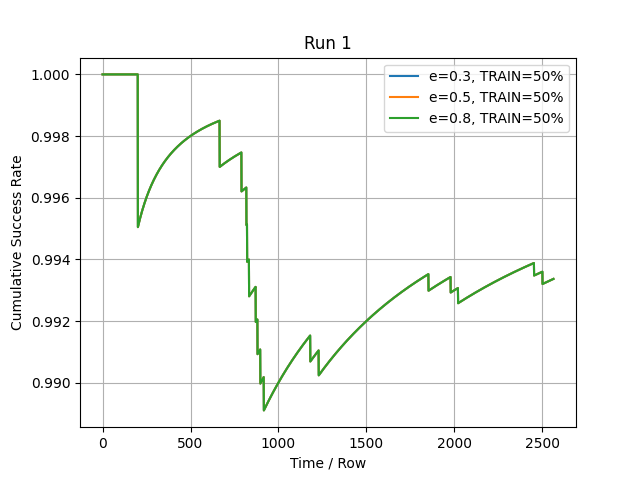

# WiFi Channel Selection with an Epsilon-Greedy Bandit

An epsilon-greedy K-armed bandit that learns which WiFi channel is least likely to cause interference, using real signal-strength traces from 11 channels in a university library.

Each channel is an arm. A reading below the threshold (-90 dBm) means the channel is free, which counts as a success. The bandit explores and exploits during the first `TRAIN%` of the data, then commits to the best channel for the rest.

## Results

The bandit consistently picks channel 4 or 3, which are free **99.3%** and **99.1%** of the time on held-out data, compared with ~86% for a randomly chosen channel and 69% for the worst. Success stayed between 98.7% and 99.3% across ε ∈ [0.1, 0.9] and TRAIN% ∈ [10, 50]; the only drops (88.9%) came from high ε with just 10% training data.

<p align="center">
  
</p>

## Usage

```bash
pip install -r requirements.txt
python3 epsilon_greedy_bandit.py data/wifi_channels.csv 0.3 50 -90
```

Arguments: `FILENAME EPSILON TRAIN% THRESHOLD`. The script prints the learned success probability for each channel and the chosen channel's success rate, then runs a sweep over ε and TRAIN% (3 runs) and saves the plots to `plots/`.
